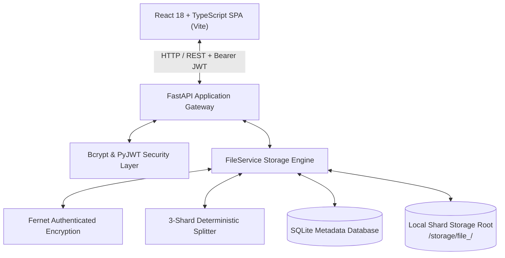

# TriVault — Secure File Storage Using Encryption and Three-Shard Storage

> **Tagline:** *Split into Three. Secured as One.*  
> **Academic Level:** Second-Year Engineering Field Project  
> **Repository:** TriVault Field Project  

---

## 1. Abstract
TriVault is a secure, decoupled web application that protects sensitive user files through a defense-in-depth pipeline combining authenticated symmetric encryption with deterministic multi-shard storage. When a registered user uploads a file, TriVault encrypts the raw byte stream using Fernet (128-bit AES in CBC mode with HMAC-SHA256 authentication). The resulting ciphertext is partitioned into exactly three sequential shards and stored in separate files on disk alongside an integrity manifest containing precomputed SHA-256 digests. File metadata and ownership records are maintained in a local SQLite database accessed via SQLModel. Retrieval requires JWT bearer authentication, ownership verification, cryptographic checksum validation of each shard, reassembly of the ciphertext, and authenticated decryption. TriVault is runnable locally on Windows without external paid dependencies or cloud accounts.

---

## 2. Problem Statement & Motivation

### The Problem
Centralized data storage systems frequently store user files in plaintext on disk or in database BLOB columns. Under this architecture:
- Any unauthorized party who gains read access to the server disk can immediately inspect sensitive documents.
- Database backups expose private files in plaintext.
- A single corrupted or tampered file may be served to users without immediate integrity failure detection.

### Motivation
In second-year engineering curricula, students learn theoretical cryptography, database schemas, and web technologies in isolation. TriVault bridges these disciplines by demonstrating how applied symmetric encryption, hash functions, and deterministic byte partitioning work together in a functional full-stack software product.

---

## 3. Project Objectives & Scope

### Core Objectives
1. **Confidentiality:** Transform uploaded files into unreadable ciphertext before writing to persistent storage.
2. **Partitioned Storage:** Deterministically divide encrypted data across exactly three separate files (`shard_1.enc`, `shard_2.enc`, `shard_3.enc`).
3. **Integrity Auditing:** Detect any single-byte tampering or missing shard file using SHA-256 manifest digests and HMAC-SHA256 signatures.
4. **Access Isolation:** Guarantee that only the authenticated user who uploaded a file can download, inspect, rename, or delete it.
5. **Educational Transparency:** Provide a polished user interface featuring a **Cryptographic Shard Inspector** modal that visually explains file sizes, shard divisions, and SHA-256 hashes to examiners.

### Project Scope & Academic Boundaries
- **In Scope:** Local filesystem sharding, Fernet symmetric encryption, salted bcrypt password hashing, stateless JWT authentication, SQLite metadata persistence, automated pytest test suite (41 tests), and a React + TypeScript SPA.
- **Out of Scope (Honest Security Boundary):** TriVault does not claim distributed cloud hosting, geographic replication, or fault tolerance. Basic sequential sharding requires all three shards to reconstruct the original data.

---

## 4. Technology Stack

| Layer | Technology | Version / Specification | Rationale |
|:---|:---|:---|:---|
| **Backend Language** | Python | 3.11+ (Tested on 3.13.7) | Modern type hinting, high developer velocity, rich security ecosystem. |
| **Backend Framework**| FastAPI | `>= 0.115.0` | High performance ASGI framework with automatic OpenAPI/Swagger docs. |
| **Server Engine** | Uvicorn | `>= 0.32.0` | Lightweight, asynchronous ASGI web server. |
| **ORM / Data Layer** | SQLModel | `>= 0.0.22` (SQLAlchemy 2.0) | Unified Pydantic schema validation and relational database mapping. |
| **Database** | SQLite | 3.x (Embedded) | ACID-compliant, zero external dependencies, file-backed. |
| **File Encryption** | Cryptography (Fernet) | `>= 43.0.0` | AES-128-CBC + PKCS7 padding + HMAC-SHA256 authenticated encryption. |
| **Password Hashing**| Bcrypt | `>= 4.2.0` | Key derivation with 12 rounds and unique salt generation per user. |
| **Tokens & Auth** | PyJWT | `>= 2.9.0` | Stateless HMAC-SHA256 (`HS256`) JSON Web Tokens. |
| **Frontend Framework**| React + TypeScript | React 18.3, TS 5.6 | Component modularity, compile-time type safety. |
| **Frontend Bundler** | Vite | 5.4+ | Fast development HMR and optimized production asset bundling. |
| **Styling & Theme** | Tailwind CSS | 3.4+ | Utility-first styling implementing a cybersecurity aesthetic. |
| **Iconography** | Lucide React | 0.454+ | Lightweight cybersecurity and system vector icons. |
| **Testing** | Pytest & TestClient | Pytest 8.3+, HTTPX | Automated test execution with isolated temporary database/storage. |

---

## 5. System Architecture & Workflows

### 5.1 Architecture Diagram



### 5.2 Upload Workflow
1. **Client Submission:** User selects a file (up to 25MB) and submits a multipart upload request with a JWT.
2. **Sanitization:** Server checks file size and removes path traversal patterns from the filename.
3. **Fernet Encryption:** Plaintext bytes are encrypted using AES-128-CBC with a 16-byte random IV and 32-byte HMAC-SHA256 signature.
4. **Three-Shard Division:** Ciphertext is divided into three ordered slices ($S_1, S_2, S_3$).
5. **Persistence:** Shards are written to `storage/file_<uuid>/` alongside `manifest.json` (recording shard sizes and SHA-256 digests).
6. **Metadata Record:** A metadata record is committed to SQLite linking the file to `current_user.id`.

### 5.3 Download Workflow
1. **Identity & Ownership Check:** The user's JWT is verified. SQLite verifies the file belongs to the requesting user.
2. **Manifest & Integrity Check:** `manifest.json` is loaded. All three shard files are read from disk, and their SHA-256 digests are compared against the manifest.
3. **Reassembly:** The shards are concatenated in exact sequence ($S_1 + S_2 + S_3$).
4. **Decryption:** Fernet verifies the HMAC signature and decrypts the ciphertext.
5. **Delivery:** The original plaintext file is delivered with safe RFC-compliant `Content-Disposition` headers.

---

## 6. Directory Structure

```
TriVault-Field-Project/
├── backend/
│   ├── app/
│   │   ├── config.py              # Validated environment settings (Pydantic)
│   │   ├── database.py            # SQLite engine & session management (SQLModel)
│   │   ├── main.py                # FastAPI app, lifespan, CORS, and health checks
│   │   ├── models/                # Database entities (User, StoredFile)
│   │   ├── schemas/               # Request and response schemas (Auth, Files)
│   │   ├── routes/                # Route handlers (/auth, /files)
│   │   ├── security/              # Cryptography, 3-sharding, passwords, JWT
│   │   └── services/              # FileService handling atomic shard I/O
│   ├── tests/                     # 41 automated pytest test cases
│   ├── storage/                   # Physical shard storage directories (file_<uuid>)
│   ├── verify_e2e.py              # Standalone 11-step E2E verification script
│   ├── requirements.txt           # Python backend dependencies
│   ├── .env.example               # Template environment variables
│   └── .gitignore
│
├── frontend/
│   ├── src/
│   │   ├── components/            # Navbar, Sidebar, Modals, Shard Inspector, Toast
│   │   ├── context/               # AuthContext for session management
│   │   ├── pages/                 # Login, Register, Dashboard, FileManager
│   │   ├── services/              # API client communicating with FastAPI
│   │   ├── types/                 # TypeScript interfaces
│   │   ├── App.tsx                # React Router & protected layout
│   │   ├── main.tsx               # Entrypoint
│   │   └── index.css              # Custom cybersecurity theme styles
│   ├── public/                    # Favicon & assets
│   ├── package.json               # Node dependencies & build scripts
│   ├── tailwind.config.js         # Theme color palette definition
│   ├── vite.config.ts             # Bundler configuration
│   └── .env.example
│
├── docs/
│   ├── ARCHITECTURE.md            # Detailed architecture and layer separation
│   ├── DATA_FLOW.md               # Upload and download flowcharts
│   ├── DATABASE.md                # Database ER diagram and schema dictionary
│   ├── SECURITY.md                # Threat model, cryptography, and limitations
│   ├── API_GUIDE.md               # Complete REST API reference
│   ├── TESTING.md                 # Test strategy and 41 passed test results
│   └── VIVA_QUESTIONS.md          # 28 professor viva questions and answers
│
├── README.md                      # Primary project documentation
├── PROJECT_STATUS.md              # Milestone tracking & verified capabilities
└── .gitignore
```

---

## 7. Local Installation & Setup Guide (Windows PowerShell)

### Prerequisites
- **Python 3.11+** installed (Tested on Python 3.13.7)
- **Node.js 18+** and **npm** installed (Tested on Node v24.12.0)
- Windows PowerShell

---

### Step 1: Backend Setup

Open a PowerShell terminal in the project root:

```powershell
# 1. Create a Python virtual environment
python -m venv backend/venv

# 2. Activate the virtual environment
.\backend\venv\Scripts\Activate.ps1

# 3. Upgrade pip and install dependencies
pip install -r backend/requirements.txt
```

#### Generate Local Cryptographic Secrets

Generate your own cryptographic keys with one command:

```powershell
python -c "from cryptography.fernet import Fernet; import secrets; print('FERNET_ENCRYPTION_KEY=' + Fernet.generate_key().decode()); print('JWT_SECRET_KEY=' + secrets.token_urlsafe(32))"
```

Create `backend/.env` (or copy from `backend/.env.example`):

```ini
APP_ENV=development
APP_HOST=127.0.0.1
APP_PORT=8000
DATABASE_URL=sqlite:///./app.db

# Paste your generated keys below
JWT_SECRET_KEY=paste_generated_jwt_secret_key_here
JWT_ALGORITHM=HS256
ACCESS_TOKEN_EXPIRE_MINUTES=1440

FERNET_ENCRYPTION_KEY=paste_generated_fernet_key_here

STORAGE_ROOT=./storage
MAX_UPLOAD_SIZE_BYTES=26214400
ALLOWED_ORIGINS=http://localhost:5173,http://127.0.0.1:5173
```

---

### Step 2: Frontend Setup

Open a second PowerShell terminal in the project root:

```powershell
# Navigate into the frontend folder
cd frontend

# Install npm dependencies
npm install

# Create frontend environment configuration
Copy-Item .env.example .env
```

Ensure `frontend/.env` contains:
```ini
VITE_API_BASE_URL=http://127.0.0.1:8000
```

---

## 8. Running the Application

### Terminal 1: Start Backend Server
```powershell
.\backend\venv\Scripts\Activate.ps1
uvicorn app.main:app --host 127.0.0.1 --port 8000 --app-dir backend --reload
```
- **Backend API:** `http://127.0.0.1:8000`
- **Interactive Swagger UI:** `http://127.0.0.1:8000/docs`
- **Health Check:** `http://127.0.0.1:8000/health`

### Terminal 2: Start Frontend Development Server
```powershell
cd frontend
npm run dev
```
- **Web Application:** `http://localhost:5173`

---

## 9. Running Verification & Automated Tests

### 9.1 Run Automated Pytest Suite (41 Tests)
```powershell
.\backend\venv\Scripts\Activate.ps1
pytest backend/tests -v
```
**Expected Outcome:** 41 passed tests covering encryption, sharding, JWT expiration, password hashing, file upload/download, integrity failures, and cross-user isolation.

### 9.2 Run Standalone E2E Pipeline Verification
```powershell
python backend/verify_e2e.py
```
**Expected Outcome:** Executes all 11 user journey steps against real SQLite and filesystem storage, verifying 3 physical shards, 0% plaintext presence, and exact downloaded byte equality.

### 9.3 Build Frontend for Production
```powershell
cd frontend
npm run build
```
**Expected Outcome:** `tsc && vite build` completes with 0 errors and generates production-ready bundle assets in `frontend/dist/`.

---

## 10. Step-by-Step Professor Demonstration Script

When presenting TriVault to a professor or evaluation committee, follow this exact 5-minute demonstration:

1. **Architecture & Swagger UI:** Open `http://127.0.0.1:8000/docs` to show the RESTful API endpoints and schema models.
2. **Registration & Login:** Open `http://localhost:5173`. Register an account (e.g. `evaluator_prof`), demonstrating password length validation and auto-login into the cybersecurity dashboard.
3. **File Upload & Live Pipeline:** Go to **File Vault** and click **Upload File**. Choose a document (e.g., a PDF or text file). Show the upload modal's 3-stage cryptographic status.
4. **Demonstrating 3 Physical Shards:**
   - In the web app, click the **Inspect Shards** (eye icon) button. Show the examiner the 3 distinct shards, their exact byte lengths, and their individual SHA-256 digests.
   - In PowerShell, show the physical storage directory:
     ```powershell
     Get-ChildItem backend\storage\file_*
     ```
     Open `shard_1.enc` in a text editor to prove it contains **binary Fernet ciphertext, not plaintext**.
5. **Integrity-Verified Download:** Click **Download** in the browser. The server validates all 3 SHA-256 checksums, reassembles the ciphertext, decrypts it, and downloads the original file. Open the file to verify it is completely intact.
6. **Cross-User Isolation Defense:** Log out, register an attacker account (`attacker_eve`), and attempt to view or download the first user's file. The vault is completely isolated and returns `404 Not Found`.
7. **Clean Deletion:** Delete the file and show that the physical folder is immediately erased from disk.
8. **Automated Evidence:** Run `pytest backend/tests -v` to show all 41 test cases passing in under 10 seconds.

---

## 11. Security Limitations & Future Scope

### Current Limitations
1. **Local Filesystem:** Shards reside in subfolders on the same physical storage system.
2. **No Redundancy:** All 3 shards are required for reconstruction. Losing any shard makes the file unrecoverable.
3. **Static Master Key:** File encryption uses a static key in `.env` rather than per-user envelope encryption.
4. **Memory Constraint:** Maximum file upload size is bounded at 25MB.

### Future Scope
1. **Shamir's Secret Sharing (k-of-n):** Introduce threshold secret sharing so files can be reconstructed if 2 out of 3 shards are available.
2. **Cloud Object Distribution:** Store Shard 1 on AWS S3, Shard 2 on Google Cloud Storage, and Shard 3 on Cloudflare R2.
3. **Envelope Encryption with KMS:** Implement per-file Data Encryption Keys (DEKs) wrapped by a Key Encryption Key (KEK) using AWS KMS or HashiCorp Vault.
4. **Chunked Streaming I/O:** Stream encrypted chunks to disk to handle multi-gigabyte file transfers.
