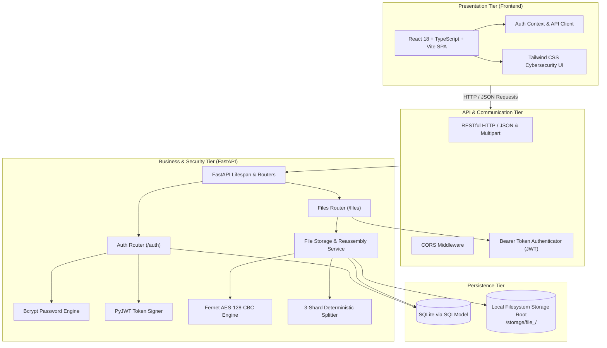

# System Architecture — TriVault

**Tagline:** Split into Three. Secured as One.  
**Project:** Secure File Storage Using Encryption and Three-Shard Storage  
**Academic Level:** Second-Year Engineering Field Project  

---

## 1. High-Level Architectural Overview

TriVault is designed as a decoupled, multi-tier web application built specifically for security, maintainability, and educational clarity. It avoids complex enterprise infrastructure (such as message queues or Kubernetes) in favor of deterministic, local-first storage that can be easily inspected, audited, and explained to examiners.

---

## 2. Component Breakdown & Responsibilities

### 2.1 Presentation Tier (Frontend)
- **Framework:** React 18 with TypeScript and Vite.
- **Styling:** Tailwind CSS using a cybersecurity palette (deep navy `#060911`, slate `#0A0F1D`, and electric cyan `#06B6D4`).
- **State & Context:** `AuthContext` provides declarative authentication state, login/logout actions, and token storage.
- **Routing:** React Router v6 provides client-side route protection through `<ProtectedRoute />`.
- **Educational Instrumentation:** Includes a dedicated **Cryptographic Shard Inspector** modal that allows students and professors to view the exact byte sizes and SHA-256 hashes of all three persisted shards for any file.

### 2.2 Security & Cryptography Layer
- **Password Protection (`app/security/passwords.py`):** Uses modern `bcrypt` key derivation with 12 computational rounds and distinct salts. Plaintext passwords never touch logs or databases.
- **Session Security (`app/security/tokens.py`):** Stateless JWTs signed with HMAC-SHA256 (`HS256`). Subject claims identify the unique user ID.
- **Authenticated Encryption (`app/security/encryption.py`):** Utilizes Fernet (AES-128-CBC with PKCS7 padding and HMAC-SHA256 authentication). Produces ciphertext with built-in tamper detection.
- **3-Shard Engine (`app/security/sharding.py`):** Partitions arbitrary-length ciphertext into exactly 3 ordered sequential byte chunks ($S_1, S_2, S_3$). Handles 0-byte, single-byte, and multi-megabyte streams deterministically.

### 2.3 Storage & Persistence Tier
- **Relational Metadata (`app/database.py`):** SQLite accessed via SQLModel (SQLAlchemy 2.0 core). Stores users, credentials hashes, and file metadata (`filename`, `storage_id`, `size`, `user_id`, `created_at`). File contents and cryptographic keys are **never** stored in the database.
- **Physical Shard Directories:** Each file is isolated in its own folder: `storage/file_<uuid>/`. Contains:
  - `shard_1.enc`: First slice of Fernet ciphertext.
  - `shard_2.enc`: Second slice of Fernet ciphertext.
  - `shard_3.enc`: Third slice of Fernet ciphertext.
  - `manifest.json`: Non-secret integrity manifest holding shard sizes, indices, and SHA-256 checksums.

---

## 3. Key Design Principles

1. **Separation of Concerns:** Route handlers only parse requests and construct responses. All storage logic resides in `FileService`, cryptographic primitives in `security/`, and database queries in repository/models.
2. **Defensive Path Validation:** All file paths are validated against directory traversal attacks (`../`, null bytes, absolute paths) using `pathlib.Path.relative_to()`.
3. **Atomic Failure Handling:** If an upload fails midway or database insertion fails, all created shard files and directories are cleanly rolled back and deleted.
4. **Honest Security Boundaries:** TriVault makes no false claims of distributed fault tolerance. Basic sharding requires all three shards to reconstruct the original data.
