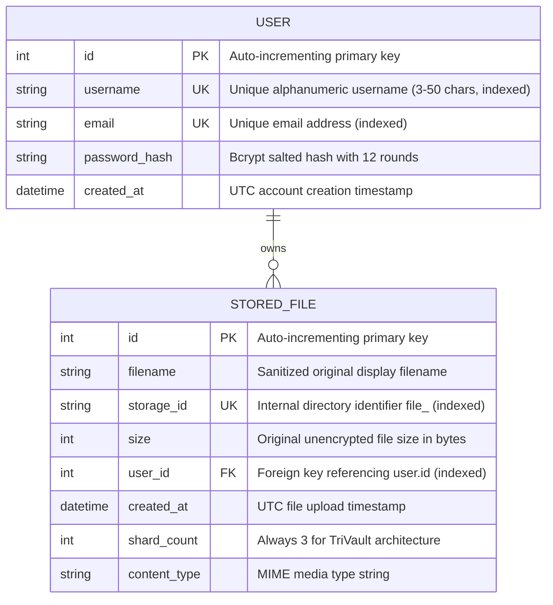

# Database Architecture & Schema — TriVault

**Tagline:** Split into Three. Secured as One.  
**Project:** Secure File Storage Using Encryption and Three-Shard Storage  

---

## 1. Entity-Relationship (ER) Diagram

---

## 2. Table Specifications

### 2.1 Table: `user`

Stores registered user credentials. Plaintext passwords are **never** persisted.

| Column | Data Type | Constraints | Description |
|:---|:---|:---|:---|
| `id` | `INTEGER` | `PRIMARY KEY AUTOINCREMENT` | Unique identifier for each account. |
| `username` | `VARCHAR(50)` | `NOT NULL, UNIQUE, INDEXED` | Chosen username for identification. |
| `email` | `VARCHAR(255)` | `NOT NULL, UNIQUE, INDEXED` | Registered user email address. |
| `password_hash`| `VARCHAR(255)` | `NOT NULL` | One-way cryptographic hash generated using `bcrypt`. |
| `created_at` | `DATETIME` | `NOT NULL, DEFAULT UTC_NOW` | Timestamp when user registered. |

### 2.2 Table: `stored_file`

Tracks ownership and metadata for files sharded and stored on disk.

| Column | Data Type | Constraints | Description |
|:---|:---|:---|:---|
| `id` | `INTEGER` | `PRIMARY KEY AUTOINCREMENT` | Unique file ID used for API endpoints. |
| `filename` | `VARCHAR(255)` | `NOT NULL, INDEXED` | Sanitized display filename. |
| `storage_id` | `VARCHAR(64)` | `NOT NULL, UNIQUE, INDEXED` | Opaque internal storage folder name (e.g. `file_7fd772cf...`). |
| `size` | `INTEGER` | `NOT NULL` | Original unencrypted file size in bytes. |
| `user_id` | `INTEGER` | `NOT NULL, FOREIGN KEY (user.id), INDEXED` | ID of the authenticated user who uploaded the file. |
| `created_at` | `DATETIME` | `NOT NULL, DEFAULT UTC_NOW` | Timestamp when file was processed and stored. |
| `shard_count` | `INTEGER` | `NOT NULL, DEFAULT 3` | Number of physical shards (strictly 3 in this version). |
| `content_type`| `VARCHAR(128)` | `NOT NULL, DEFAULT 'application/octet-stream'` | MIME media type for safe browser downloads. |

---

## 3. Database Design Rationale

### Why SQLite with SQLModel?
1. **Zero External Dependencies:** SQLite is embedded directly into the Python process. It requires no separate database server, no network port opening, and no paid hosting.
2. **ACID Compliance:** SQLite provides full atomic transactions (`BEGIN`, `COMMIT`, `ROLLBACK`), ensuring metadata consistency during upload and deletion operations.
3. **Type Safety via SQLModel:** SQLModel unifies Pydantic schemas and SQLAlchemy models into a single codebase, preventing schema synchronization bugs.

### Architectural Prohibitions
- **No File Bytes in SQLite:** File contents (BLOBs) cause database bloat, slowing down index lookups and cache efficiency. TriVault stores encrypted shards on the filesystem and only references them via `storage_id`.
- **No Cryptographic Keys in SQLite:** Encryption keys are never written to database tables. Keys reside strictly in validated environment variables.
