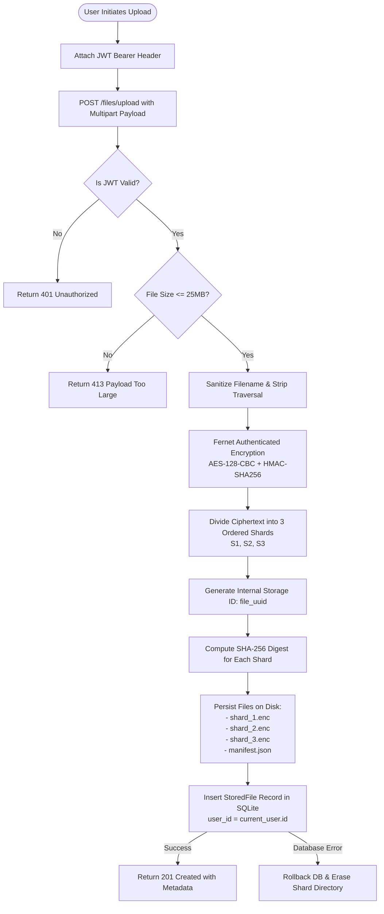

# Data Flow & Pipelines — TriVault

**Tagline:** Split into Three. Secured as One.  
**Project:** Secure File Storage Using Encryption and Three-Shard Storage  

---

## 1. Upload Pipeline Flowchart



### Detailed Upload Stages
1. **Payload Ingestion:** The client sends the file via HTTP multipart form data accompanied by an `Authorization: Bearer <token>` header.
2. **Size & Filename Sanitization:** The server verifies the file size does not exceed `MAX_UPLOAD_SIZE_BYTES` (25MB). The filename is stripped of path traversal sequences (`../`, `/`, `\`), null bytes, and quote injections.
3. **Fernet Encryption:** Plaintext bytes $P$ are transformed into ciphertext $C$:
   $$C = \text{Fernet}_{\text{key}}(P)$$
   Fernet adds a 16-byte random IV, a 64-bit UTC timestamp, PKCS7 padding, and a 32-byte HMAC-SHA256 authentication tag.
4. **Three-Shard Splitting:** The ciphertext $C$ of length $L$ is partitioned into 3 slices:
   - Base chunk size: $B = \lfloor L / 3 \rfloor$
   - Remainder: $R = L \pmod 3$
   - $\text{Length}(S_1) = B + (1 \text{ if } R > 0 \text{ else } 0)$
   - $\text{Length}(S_2) = B + (1 \text{ if } R > 1 \text{ else } 0)$
   - $\text{Length}(S_3) = B$
5. **Persistence:** The shards are written to `storage/file_<uuid>/` along with `manifest.json`.
6. **Metadata Record:** A metadata entry is committed to SQLite linking the file to `current_user.id`.

---

## 2. Download Pipeline Flowchart

```mermaid
flowchart TD
    Start([User Requests Download]) --> AuthCheck[Validate JWT & Resolve Current User]
    AuthCheck --> LookupDB{Find StoredFile\nWHERE id = :id AND user_id = :uid}
    
    LookupDB -->|Not Found / Wrong Owner| Return404[Return 404 Not Found]
    LookupDB -->|Found| ReadManifest[Read manifest.json from Storage Path]
    
    ReadManifest --> ValidateManifest{Is Manifest Valid?\nexpected_count == 3}
    ValidateManifest -->|Corrupted| IntegrityFail[Return 500 Integrity Failure]
    
    ValidateManifest -->|Valid| ReadShards[Read shard_1.enc, shard_2.enc, shard_3.enc]
    ReadShards --> VerifyDigests{Compute SHA-256 for Each Shard\nMatches Manifest Digest?}
    
    VerifyDigests -->|Mismatch / Missing| IntegrityFail
    VerifyDigests -->|Matches| Combine[Concatenate Shards:\nC = S1 + S2 + S3]
    
    Combine --> Decrypt[Fernet Decryption & HMAC Validation\nP = Decrypt(C)]
    
    Decrypt -->|HMAC Tamper Error| IntegrityFail
    Decrypt -->|Success| StreamFile[Return File Response\nContent-Disposition: attachment; filename=...]
```

### Detailed Download Stages
1. **Ownership Enforcement:** The request must carry a valid JWT. The user ID in the token is matched against `StoredFile.user_id`. Any cross-user attempt results in an immediate `HTTP 404 Not Found` (preventing ID enumeration).
2. **Manifest Verification:** The system locates `storage/file_<uuid>/manifest.json` and parses the shard list.
3. **Cryptographic Checksum Audit:** For each shard file (`shard_1.enc`, `shard_2.enc`, `shard_3.enc`):
   - The file is read from disk.
   - Its byte length is compared with the manifest.
   - Its SHA-256 checksum is computed and checked against the recorded hash.
4. **Reassembly:** The 3 shards are joined sequentially into a single continuous byte sequence:
   $$C = S_1 \mathbin{\Vert} S_2 \mathbin{\Vert} S_3$$
5. **Authenticated Decryption:** Fernet verifies the 32-byte HMAC tag. If valid, AES-128-CBC decrypts $C$ to yield the original plaintext $P$.
6. **Safe Browser Delivery:** The payload is returned with RFC 5987 / RFC 6266 headers:
   `Content-Disposition: attachment; filename="name.ext"; filename*=UTF-8''name.ext`
